<p align="center">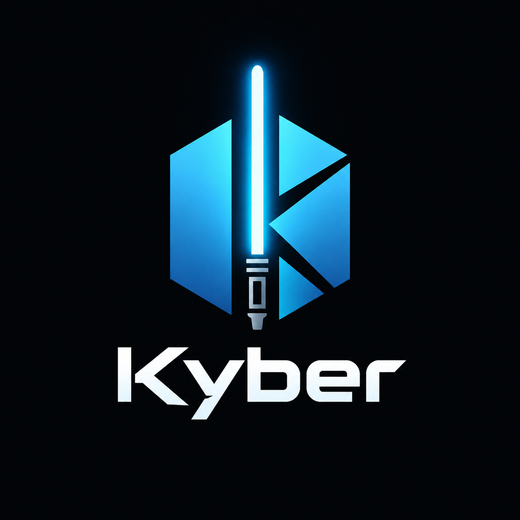</p>
<h1 align="center">Kyber</h1>
<p align="center">Open-source, self-hosted issue &amp; project tracker — the core of Jira, in one Go binary.</p>

> Status: **v0.10 (Sprint 10)** — configurable workflows per project (statuses with To Do / In Progress / Done
> categories), Scrum & Kanban boards with status-mapped columns and WIP limits, backlog & sprints, reports (burndown,
> velocity, created vs resolved, cycle time, workload), notifications & @mentions, Pomodoro focus with a meetings
> time table, eye-break exercises, Jira CSV import/export, Google, GitHub, OpenID Connect SSO & Telegram sign-in, multi-tenant workspaces on
> subdomains, Slack-style chat (threads, mentions, @groups, saved items, reminders, scheduled messages, statuses &
> DND, channel sections, slash commands, project channels, workflows, incoming webhooks) with video huddles
> (screen share, recording, transcripts, reactions) and shared whiteboards,
> OpenAPI contract, localized errors (en/uz/ru), PostgreSQL, optional Redis.

<p align="center">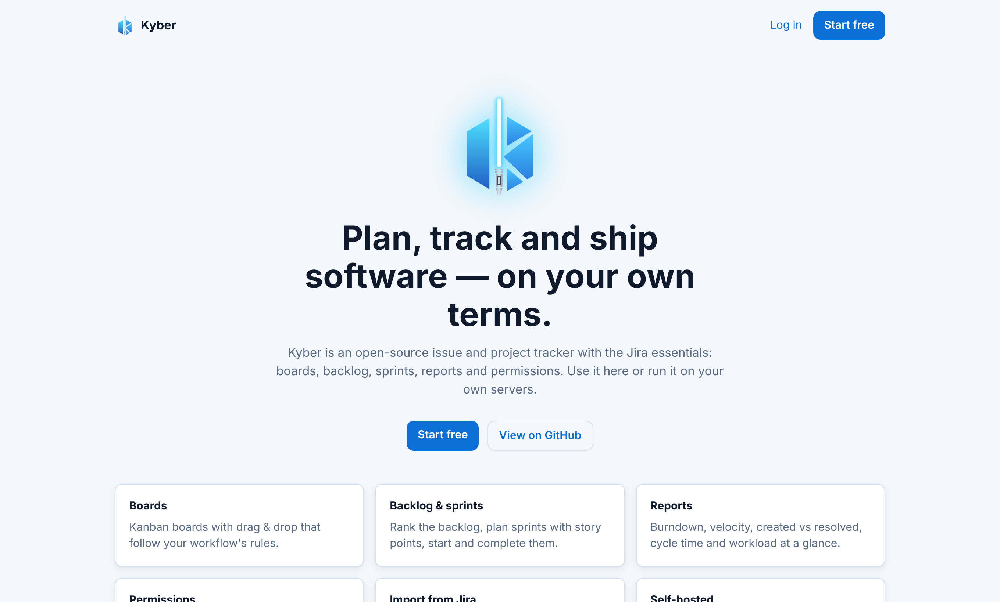</p>

| | |
|---|---|
| 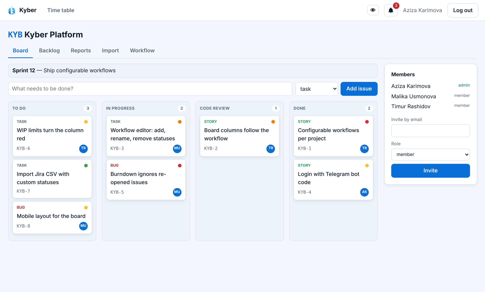 | 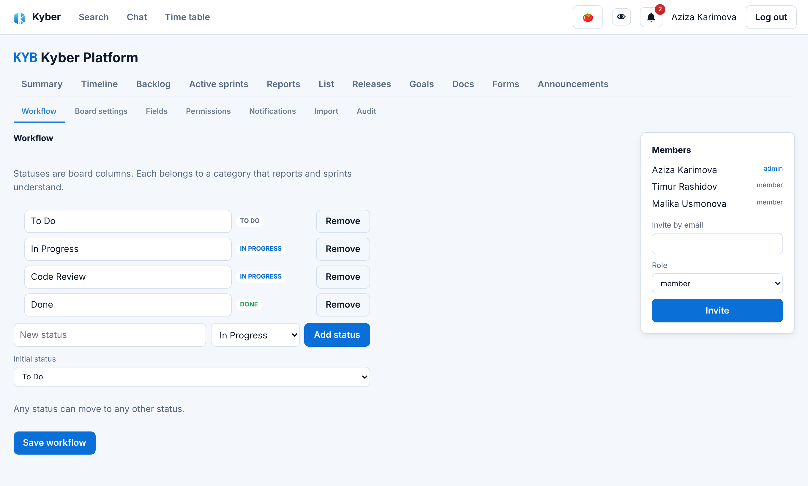 |
| **Board** — columns follow the project's workflow; drag cards between statuses. | **Workflow** — add, rename and remove statuses; each has a Jira category. |
| 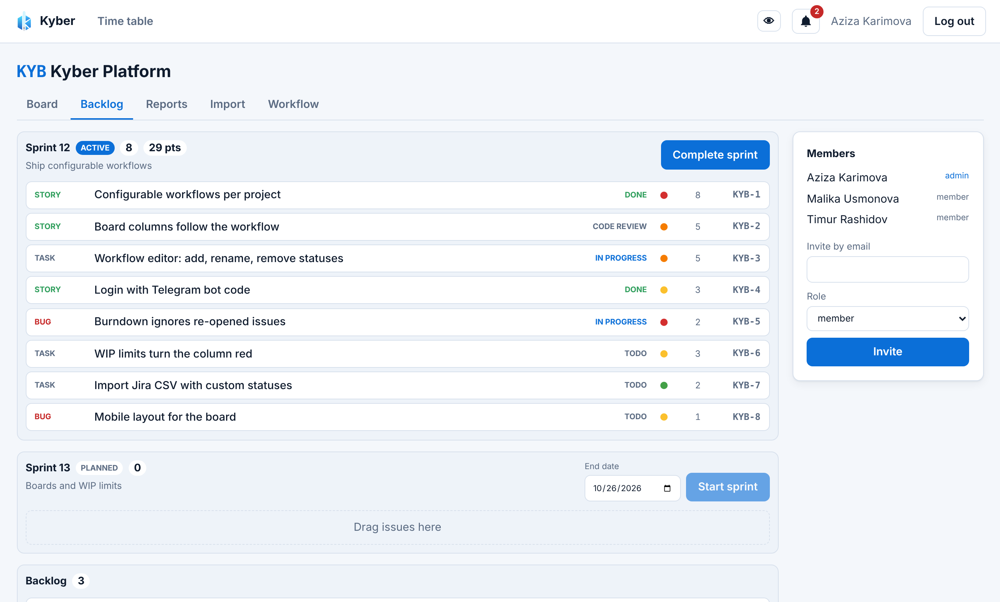 | 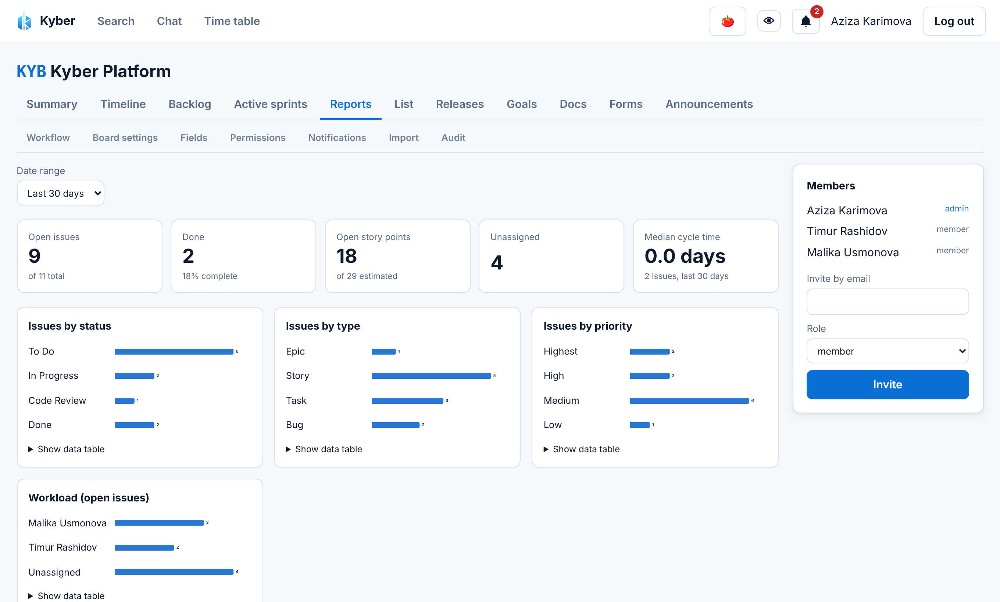 |
| **Backlog & sprints** — rank issues, plan, start and complete sprints. | **Reports** — KPIs, distributions, burndown, velocity, cycle time. |
| 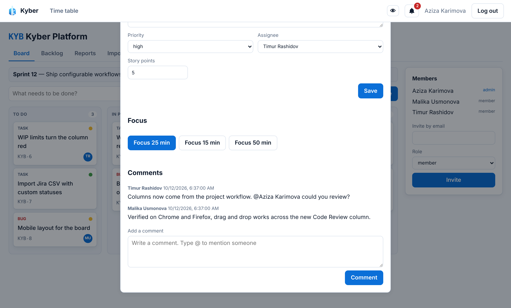 | 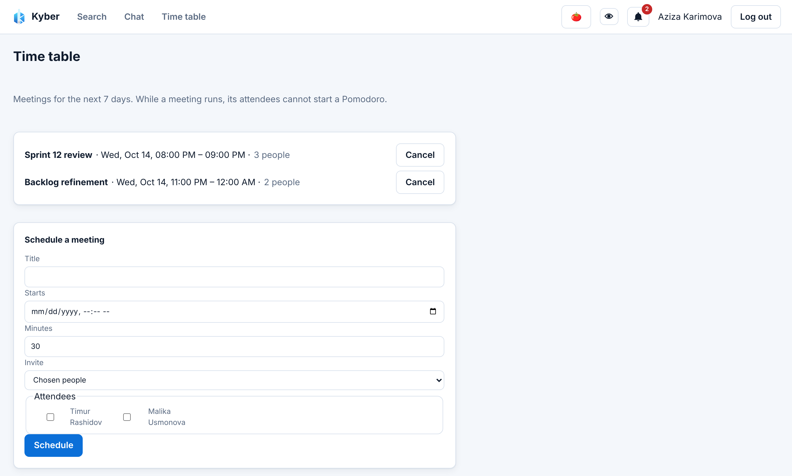 |
| **Issue** — details, Pomodoro focus, comments with @mentions. | **Time table** — no Pomodoro can start during a meeting. |
| 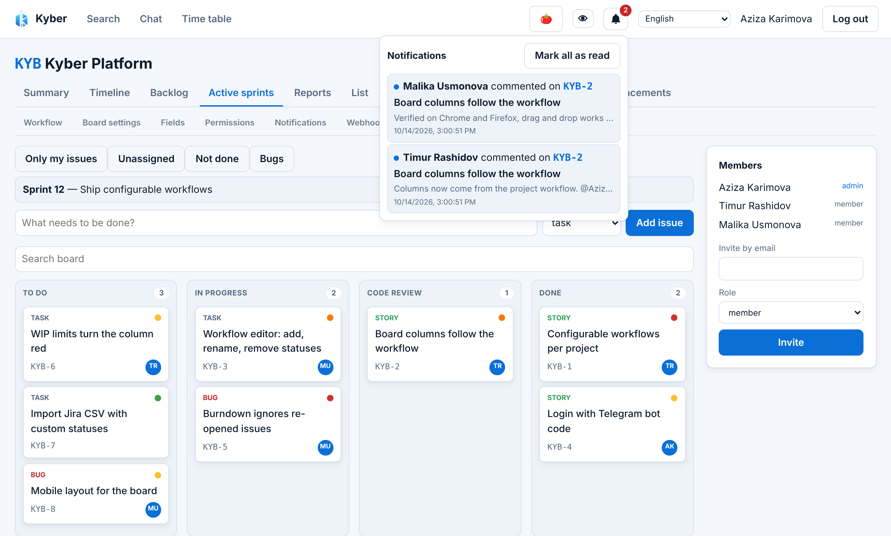 | 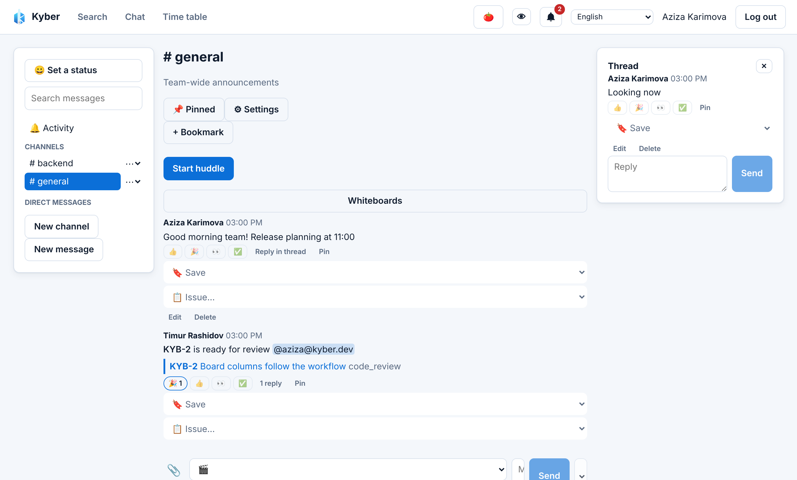 |
| **Notifications** — comments and mentions, per workspace. | **Chat** — channels, DMs, threads, reactions, @mentions, pins, search, files, issue previews. |
| 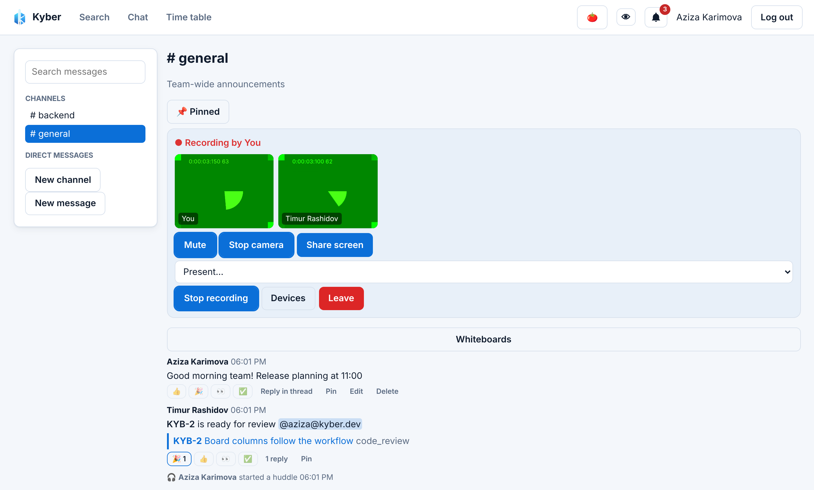 | 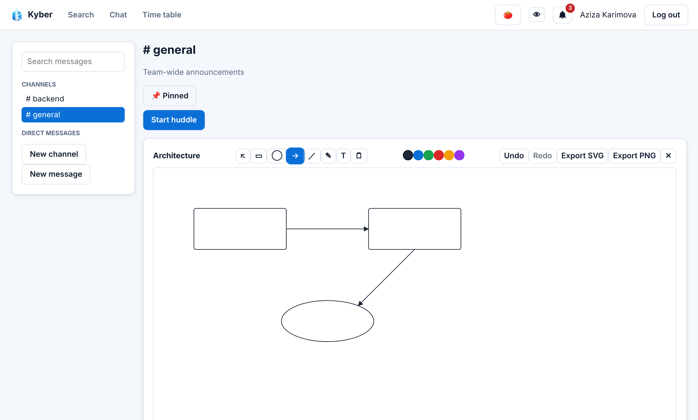 |
| **Huddles** — video, audio and screen share (WebRTC, up to 6), present a doc or whiteboard to everyone, record to the channel, transcripts and summaries. | **Whiteboards** — an infinite canvas drawn together live: shapes, styles, templates, images, comments; stickies become issues; export SVG/PNG. |
| 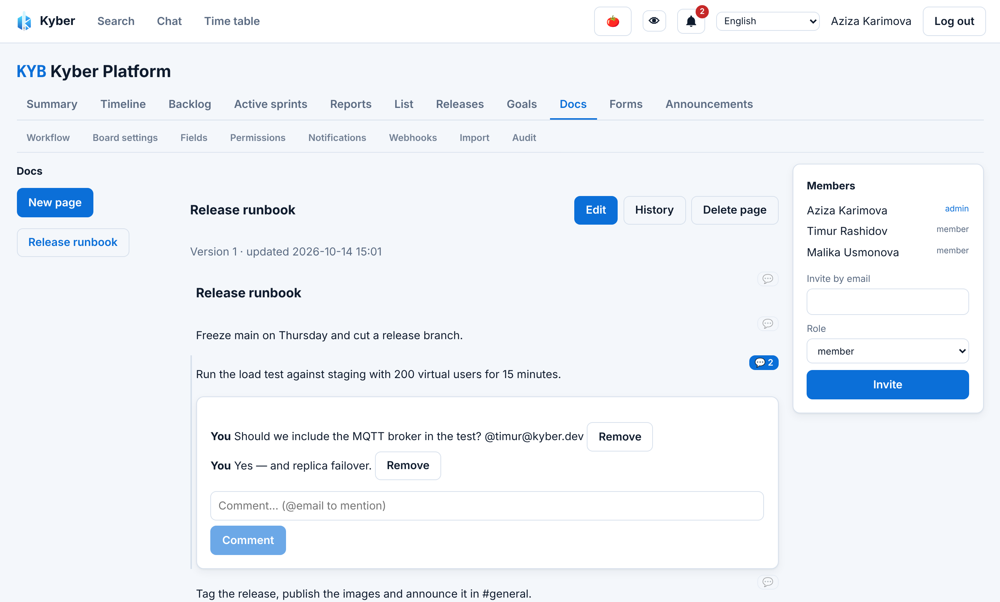 | |
| **Docs** — Markdown pages with history; comment on a paragraph, @mentions notify. | |

Screenshots are generated from a seeded demo with `make screenshots`.

> Documentation: [bakhod1r.github.io/kyber](https://bakhod1r.github.io/kyber/) · Roadmap: [`docs/PLAN.md`](docs/PLAN.md) · Backlog: [`docs/backlog`](docs/backlog) · QA: [`docs/qa`](docs/qa)

## Quick start

```bash
docker compose up --build    # PostgreSQL + Kyber (UI + API) on http://localhost:8080

curl -XPOST localhost:8080/api/v1/auth/signup -d '{"email":"me@example.com","name":"Me","password":"a long password"}'
TOKEN=$(curl -s -XPOST localhost:8080/api/v1/auth/login -d '{"email":"me@example.com","password":"a long password"}' | jq -r .token)
H="Authorization: Bearer $TOKEN"
curl -H "$H" -XPOST localhost:8080/api/v1/projects -d '{"key":"KYB","name":"Kyber"}'
curl -H "$H" -XPOST localhost:8080/api/v1/projects/KYB/issues -d '{"title":"Login page","type":"task"}'
curl -H "$H" -XPOST localhost:8080/api/v1/issues/KYB-1/transitions -d '{"to":"in_progress"}'
```

| Env | Default | Purpose |
|---|---|---|
| `KYBER_ADDR` | `:8080` | Listen address |
| `KYBER_ATTACHMENTS_DIR` | `./data/attachments` | Uploaded files (`<dir>/<workspace>/<id>`, at most 25 MiB each); back it up together with the database |
| `KYBER_S3_BUCKET` · `KYBER_S3_ENDPOINT` · `KYBER_S3_REGION` · `KYBER_S3_ACCESS_KEY` · `KYBER_S3_SECRET_KEY` · `KYBER_S3_TLS` | — · `s3.amazonaws.com` · — · — · — · `true` | Store attachments in an existing S3/MinIO bucket instead of the directory (endpoint is `host[:port]`) |
| `KYBER_MQTT_ADDR` | — | Also serve plain MQTT for integrations (e.g. `:1883`; username = workspace id, password = access token). Browsers use MQTT over WebSocket at `/api/v1/mqtt` (ADR-0013) |
| `KYBER_GITHUB_WEBHOOK_SECRET` | — | Enables `POST /api/v1/integrations/github`: add it as a GitHub webhook (content type JSON, events *Pushes* and *Pull requests*) with this secret; commits and PRs mentioning `KEY-123` appear under **Development** on the issue (ADR-0014) |
| `KYBER_SAML_IDP_METADATA_URL` / `KYBER_SAML_IDP_METADATA_FILE` | — | Enables "Continue with SAML" (ADR-0017). Also set `KYBER_SAML_CERT_FILE` / `KYBER_SAML_KEY_FILE` (the service provider's RSA certificate and key, PEM) and register `<KYBER_PUBLIC_URL>/api/v1/auth/saml/metadata` at the identity provider; `KYBER_SAML_NAME` labels the button |
| `KYBER_SCIM_TOKEN` | — | Enables SCIM 2.0 provisioning at `/scim/v2` (ADR-0017); the identity provider sends it as a Bearer token. Deprovisioned users are deactivated, not deleted |
| `KYBER_API_RATE_LIMIT` | `1200` | API requests per signed-in user per minute; over it the API answers 429 `RATE_LIMITED` with `Retry-After` (0 = off; shared across replicas with `KYBER_REDIS_URL`) |
| `KYBER_UPLOAD_RATE_LIMIT` | `60` | Attachment/file uploads per user per minute (0 = off) |
| `KYBER_WEBHOOK_ALLOW_PRIVATE` | `false` | Let project webhooks reach loopback/private/link-local addresses (refused by default against SSRF; ADR-0014) |
| `KYBER_DATABASE_URL` | — | PostgreSQL URL; unset = in-memory dev mode. Connect as a non-superuser role so row-level security (ADR-0010) applies |
| `KYBER_REDIS_URL` | — | Optional; shares the login limiter across replicas (guard) |
| `OTEL_EXPORTER_OTLP_ENDPOINT` | — | Enables OpenTelemetry tracing (OTLP/HTTP, e.g. `http://otel-collector:4318`); unset = tracing off. The standard `OTEL_*` variables apply (`OTEL_EXPORTER_OTLP_HEADERS`, `OTEL_TRACES_SAMPLER`, `OTEL_RESOURCE_ATTRIBUTES`, `OTEL_SDK_DISABLED`). See ADR-0006 |
| — | — | Operators: `kyber outbox dead-letters` lists outbox events parked after 10 failed deliveries, `kyber outbox retry <id>` queues one again (needs `KYBER_DATABASE_URL`; ADR-0007) |
| `KYBER_ADMIN_EMAILS` | — | Comma-separated emails administering the default workspace (single-tenant mode): they publish workspace-wide announcements. Named workspaces use their owners and admins |
| `KYBER_PUBLIC_URL` | `http://localhost:8080` | External base URL; OAuth redirect URIs are built from it |
| `KYBER_GOOGLE_CLIENT_ID` / `KYBER_GOOGLE_CLIENT_SECRET` | — | Enables "Continue with Google". Google Cloud → APIs & Services → Credentials → OAuth client (Web); authorized redirect URI `<KYBER_PUBLIC_URL>/api/v1/auth/google/callback` |
| `KYBER_OIDC_ISSUER` / `KYBER_OIDC_CLIENT_ID` / `KYBER_OIDC_CLIENT_SECRET` | — | Enables single sign-on with any OpenID Connect provider (Okta, Keycloak, Microsoft Entra ID, Authentik…), found by discovery at `<issuer>/.well-known/openid-configuration`. Register redirect URI `<KYBER_PUBLIC_URL>/api/v1/auth/oidc/callback`; the provider must send `email_verified=true`. A verified email links to the existing account (ADR-0015) |
| `KYBER_OIDC_NAME` | `SSO` | Label of the single sign-on button ("Continue with …") |
| `KYBER_OIDC_GROUPS_CLAIM` | `groups` | ID-token claim holding the user's groups; mapped to roles by site admins on the Administration page (ADR-0015, S106) |
| `KYBER_SAML_GROUPS_ATTRIBUTE` | `groups` / `memberOf` | SAML attribute holding the user's groups, mapped like the OIDC claim |
| `KYBER_ENCRYPTION_KEY` | — | 32 random bytes in base64 (`openssl rand -base64 32`). Seals secrets stored in the database, such as the client secrets of SSO connections that site admins add on the Administration page (ADR-0018). Without it, SSO connections cannot be stored. Keep it safe: losing it makes stored secrets unreadable |
| `KYBER_GITHUB_CLIENT_ID` / `KYBER_GITHUB_CLIENT_SECRET` | — | Enables "Continue with GitHub". GitHub → Settings → Developer settings → OAuth Apps; callback URL `<KYBER_PUBLIC_URL>/api/v1/auth/github/callback`. Only the primary verified email links to an existing account |
| `KYBER_TELEGRAM_BOT_TOKEN` / `KYBER_TELEGRAM_BOT_NAME` | — | Enables Telegram sign-in. Create a bot with @BotFather. With both set the bot also sends **one-time login codes** (works on any domain; Kyber long-polls the bot, so run one replica with the token). The Login Widget additionally needs `/setdomain` to your site's domain. Users can also **connect Telegram for notifications** (Notifications page → Connect Telegram → press Start in the bot), and project admins can **connect Telegram groups** to a project (project → Notifications → Connect a Telegram group) |
| `KYBER_SMTP_HOST` / `_PORT` / `_USERNAME` / `_PASSWORD` / `_FROM` / `_TLS` | — / by TLS mode / — / — / `Kyber <noreply@localhost>` / `starttls` | Email notifications through any SMTP server (Gmail, Mailgun, Postfix…). `_TLS`: `starttls` (port 587), `tls` (465) or `none` (local relay). Failed sends are retried with backoff for about 2½ hours |
| `KYBER_COOKIE_SECURE` | `true` | Set `false` only for plain-HTTP local use |
| `KYBER_SESSION_PURGE_EVERY` | `1h` | Expired-session cleanup interval (jittered) |

## API (v1)

Full contract: [`api/openapi.yaml`](api/openapi.yaml) (OpenAPI 3.1, enforced by the test suite).
Errors are [RFC 9457](https://www.rfc-editor.org/rfc/rfc9457) `application/problem+json` with a stable `code`; titles follow `Accept-Language` (en, uz, ru).

| Method | Path | Description |
|---|---|---|
| GET | `/healthz` · `/readyz` · `/metrics` | Liveness · readiness (DB) · Prometheus |
| POST | `/api/v1/auth/signup` · `/auth/login` · `/auth/logout` | Accounts & sessions (cookie or Bearer) |
| GET | `/api/v1/me` | Current user |
| GET · POST · DELETE | `/api/v1/me/tokens[/{id}]` | Personal access tokens (`kpat_…`, secret shown once; not usable with a token) |
| GET / POST | `/api/v1/projects/{key}/members` | List members / add or change a member's role (admin) |
| POST / GET | `/api/v1/projects` | Create / list projects |
| GET | `/api/v1/projects/{key}` | Get project |
| POST / GET | `/api/v1/projects/{key}/issues[?status=]` | Create / list issues |
| GET · PATCH | `/api/v1/issues/{KEY-N}` | Get issue · edit title/description/priority/assignee (with `version`) |
| GET · POST | `/api/v1/issues/{KEY-N}/comments` | List · add comments |
| GET · POST | `/api/v1/issues/{KEY-N}/attachments` | List · upload files (multipart `file`, ≤ 25 MiB) |
| GET · DELETE | `/api/v1/attachments/{id}` | Download (images/PDF inline, others as attachment) · remove |
| GET · POST · PUT · DELETE | `/api/v1/projects/{key}/webhooks[/{id}]` | Project webhooks (admins): signed JSON POSTs of project events (`X-Kyber-Signature: sha256=…`, identifiers only, retried with backoff); secret shown once (ADR-0014) |
| GET | `/api/v1/projects/{key}/webhooks/{id}/deliveries` | The webhook's 20 latest deliveries (status, attempts, last response) |
| GET | `/api/v1/issues/{KEY-N}/development` | Commits and pull requests that mention the issue |
| POST | `/api/v1/integrations/github` | GitHub webhook receiver (verified with `X-Hub-Signature-256`) |
| POST | `/api/v1/issues/{KEY-N}/rank` | Move in the backlog (`after` / `before` another issue) |
| GET · POST | `/api/v1/projects/{key}/sprints` | List · create sprints |
| POST | `/api/v1/sprints/{id}/start` · `/complete` | Start · complete (unfinished issues return to the backlog) |
| GET | `/api/v1/projects/{key}/reports/summary` · `/created-vs-resolved?days=` · `/velocity` | KPIs & distributions · daily flow · committed vs completed |
| GET | `/api/v1/sprints/{id}/burndown` | Remaining story points (step line) + ideal line |
| GET | `/api/v1/notifications[?unread=true]` | Your notifications (assigned, commented, `@email` mentioned) + unread count |
| POST | `/api/v1/notifications/{id}/read` · `/read-all` | Mark one · all as read |
| GET · PUT | `/api/v1/me/notification-settings` | Email/Telegram channels and your IANA `time_zone` (meeting times in messages; UTC when unset) |
| GET · POST | `/api/v1/meetings` | Your time table · schedule a meeting (people, a project or the workspace) |
| PUT · DELETE | `/api/v1/meetings/{id}` | Reschedule (title/start/end, organizer only; attendees are told and reminded again) · cancel |
| POST | `/api/v1/issues/{KEY-N}/transitions` | Move issue (`todo ⇄ in_progress ⇄ done`) |

## AI assistants (MCP)

Kyber is a [Model Context Protocol](https://modelcontextprotocol.io) server at `POST /api/v1/mcp`
(Streamable HTTP, ADR-0009). Tools: `list_projects`, `search_issues` (JQL), `get_issue`, `create_issue`, `update_issue`, `transition_issue`, `assign_issue`, `add_comment`, `get_comments`, `list_members`, `list_sprints`; each runs with your own permissions. Create a personal access token
in **Settings → Access tokens** (ADR-0012) and keep it out of shared config files:

```sh
claude mcp add --transport http kyber https://kyber.example.com/api/v1/mcp \
  --header "Authorization: Bearer $KYBER_TOKEN"
```

Clients that support MCP authorization need no token at all: add the URL, and the client discovers
Kyber's OAuth 2.1 server, registers itself and opens a consent page where you approve it (PKCE,
ADR-0016). The access token it receives appears under **Settings → Access tokens** as
`MCP: <client>`, where you can revoke it. Set `KYBER_PUBLIC_URL` so the metadata carries your external URL.

## Development

Domain-Driven Design + Test-Driven Development — see [`CLAUDE.md`](CLAUDE.md) and `docs/PLAN.md` §3.5–3.6.

Roles: `admin` (manage members) ⊃ `member` (create/move issues) ⊃ `viewer` (read). Non-members get `404`.

```bash
make web          # build the React UI (embedded into the Go binary)
make lint test build
make web-test     # typecheck + Vitest
make e2e          # Playwright against a fresh server
KYBER_TEST_DATABASE_URL=postgres://… make test   # + PostgreSQL integration tests
```

## Built with

Kyber reuses the author's libraries: [emailx](https://github.com/bakhod1r/emailx), [errorx](https://github.com/bakhod1r/errorx),
[guard](https://github.com/bakhod1r/guard), [oneenv](https://github.com/bakhod1r/oneenv), [jitterx](https://github.com/bakhod1r/jitterx),
[ctxsentinel](https://github.com/bakhod1r/ctxsentinel) — plus pgx, React and TanStack Query.

## License

MIT — see [LICENSE](LICENSE).
